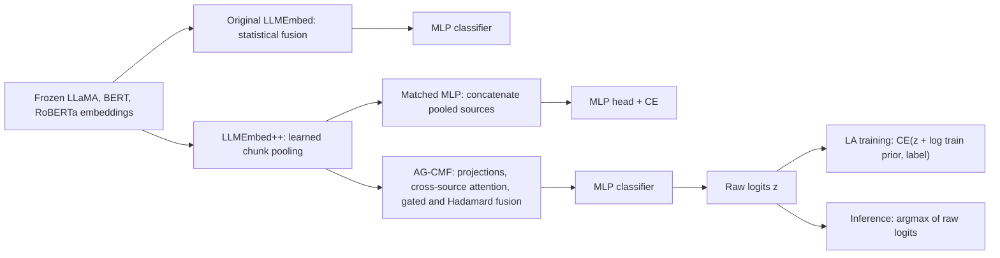
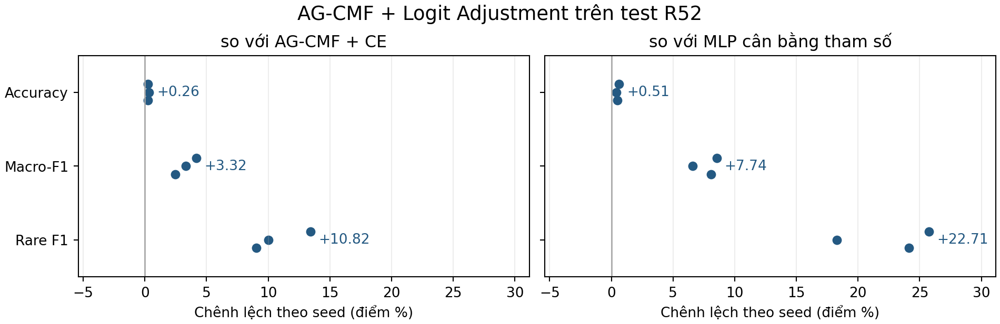

# Class-Imbalance-Aware Adaptive Embedding Fusion

How much of minority-class performance comes from the fusion architecture, and how much comes from the training objective? We study this question on **R52**, a long-tailed Reuters topic classification benchmark with 52 labels. Eighteen labels have only 1–9 training examples. Overall accuracy alone gives little visibility into these classes.

On the fixed R52 FP16 embeddings, **AG-CMF with training-time Logit Adjustment (τ = 1)** reached **96.04% accuracy, 80.24% Macro-F1, and 61.09% Rare F1** on the held-out test set. The selected recipe keeps the AG-CMF architecture and its 29,024,245 trainable parameters. [Final report](research/FINAL_REPORT.md)

## Research lineage

| Stage | Contribution |
|---|---|
| Original LLMEmbed (ACL 2024) | Frozen LLaMA, BERT, and RoBERTa representations, statistical **Cat + Co + Avg + Cat** fusion, and an MLP classifier. |
| LLMEmbed++ by ThanhNosaur and contributors | Layer selection, prompt-based extraction, overlapping chunks and learned chunk pooling, and **Adaptive Gated Cross-Model Fusion** (AG-CMF, Exp 4). The upstream experiments also include statistical and parameter-matched controls. |
| This extension | Controlled pilots of hierarchical routing and training-time logit adjustment, followed by a three-seed held-out confirmation of the selected objective. The analysis includes train-frequency groups, paired comparisons, and exact-duplicate sensitivity. |

We integrate and evaluate an existing imbalance-aware objective on the existing AG-CMF head. [LLMEmbed paper](https://aclanthology.org/2024.acl-long.433/) · [Original implementation](https://github.com/ChunLiu-cs/LLMEmbed-ACL2024) · [LLMEmbed++](https://github.com/ThanhNosaur/LLMEmbed/tree/88f1089d9275d942f22736ad01a256ecde49fd66) · [Logit Adjustment](https://arxiv.org/abs/2007.07314)

## Architecture and controls



| Method | Role | Evaluation |
|---|---|---|
| AG-CMF + CE | Primary baseline | Validation and held-out test |
| Parameter-Matched MLP + CE | Architectural control | Held-out test |
| Hierarchical Adaptive Fusion + CE | Architecture pilot. A shared scorer first weights five LLaMA layers, then weights the LLaMA summary, BERT, and RoBERTa. | Validation, seed 42 |
| AG-CMF + Logit Adjustment | Objective study. During training, the loss adds τ times the log of the train-only class prior to the classifier logits. | Validation and held-out test |

Feature extraction is frozen. The head learns chunk pooling, fusion, and classification. In the final method, the prior enters the training loss and inference uses the raw classifier logits. [Objective](llmembed_research/objective.py) · [Hierarchical gate](llmembed_research/fusion.py)

## R52 results

Held-out test, **mean ± sample standard deviation** over matched seeds 42, 43, and 44. Every head used the same FP16 cache, data split, and validation-accuracy checkpoint rule.

| Method | Accuracy (%) | Macro-F1 (%) | Rare F1 (%) |
|---|---:|---:|---:|
| Parameter-Matched MLP + CE | 95.53 ± 0.08 | 72.50 ± 0.94 | 38.37 ± 2.63 |
| AG-CMF + CE | 95.78 ± 0.15 | 76.92 ± 0.72 | 50.27 ± 2.08 |
| **AG-CMF + Logit Adjustment** | **96.04 ± 0.13** | **80.24 ± 1.31** | **61.09 ± 4.04** |

Compared with AG-CMF + CE, the objective increased accuracy by **0.26 percentage points**, Macro-F1 by **3.32**, and Rare F1 by **10.82** without adding parameters. Each metric improved in every paired seed. Removing six test documents with exact training-text matches left the conclusion intact. Medium-class Macro-F1 decreased by 1.48 points. [Per-seed results](research/audit/r52_confirmation/study_metrics.csv) · [Paired results](research/audit/r52_confirmation/study_paired_summary.csv) · [Per-class results](research/audit/r52_confirmation/per_class_summary.csv)



The hierarchical gate reduced the mean LLaMA routing mass from 90.61% to 85.88% on validation. Macro-F1 fell by 0.51 points and Rare F1 held steady, so the architecture missed the pilot selection criterion. Training-time adjustment improved validation Macro-F1 by 13.30 points with a 0.30-point accuracy decrease. That validation comparison selected the objective before the held-out test. The pilot Macro-F1 and Rare F1 use classes with validation support. [Pilot metrics](research/audit/r52_pilot/study_metrics.csv) · [Frozen decision](research/audit/r52_pilot/decision.json)

### Historical accuracy on R52

Original LLMEmbed reported **95.68%** in Table 2. The teammate's FP16 AG-CMF run reported **95.81%**. This study's AG-CMF + Logit Adjustment reached **96.04%**. Treat these as reference values across different protocols, backbones, extraction procedures, and preprocessing. The table above supplies the controlled comparison. [Original Table 2](https://aclanthology.org/2024.acl-long.433.pdf) · [Teammate results at the pinned revision](https://github.com/ThanhNosaur/LLMEmbed/blob/88f1089d9275d942f22736ad01a256ecde49fd66/kaggle_experiment/reports/README.md)

## Reproduce the reported metrics

From the repository root, use Python 3.11 or later. Metric reproduction reads the archived prediction CSVs and requires no packages or GPU.

```bash
python -m llmembed_research.results --output outputs/r52_summary.csv
python -m pip install -r requirements-research.txt
python -m unittest discover -s tests -v
```

The verifier reconstructs the original and duplicate-filtered test results and checks all three headline metrics for all nine runs. [Verification notebook](notebooks/verify_r52.ipynb) · [Training protocol and commands](research/REPRODUCIBILITY.md) · [Recorded config](configs/r52.json)

The original GPU runs used Kaggle T4 ×2. The linked runs and their feature outputs are access-controlled. Readers with the permissioned study checkout and a compatible cache can start directly at downstream training. [Kaggle preflight](https://www.kaggle.com/code/longvucs/llmembed-fusion-r52-preflight) · [Kaggle extraction, v2](https://www.kaggle.com/code/longvucs/llmembed-fusion-r52-fp16-extraction) · [Kaggle downstream, v6–v9](https://www.kaggle.com/code/longvucs/llmembed-fusion-fp16-downstream)

## Repository structure

| Path | Contents |
|---|---|
| `llmembed_research/` | Logit adjustment, hierarchical gate, and independent prediction verifier |
| `configs/` | Measured R52 run configuration |
| `notebooks/` | CPU-only walkthrough for reproducing test metrics |
| `tests/` | Objective, routing, and results checks |
| `research/` | Report, study protocol, provenance, and verified results |

## Limitations and attribution

- The objective was confirmed on R52. The Ohsumed FP16 cache is access-controlled, so the Ohsumed numbers in the report are historical context.
- The parameter-matched MLP uses CE. A matched MLP trained with Logit Adjustment remains untested.
- Gate weights and representation similarities are observational. The objective comparison isolates a change to the training loss, while attribution to a particular fusion path remains open.
- This release includes study-authored code and numeric outputs. The original and teammate repositories had no discoverable license at release, so their implementation, embedded notebook payloads, and histories are excluded from the public archive. Full training reproduction requires a permissioned checkout. Dataset text, weights, and feature caches are obtained separately. [Reproducibility and provenance](research/REPRODUCIBILITY.md)

Thanks to Liu et al. for [LLMEmbed](https://aclanthology.org/2024.acl-long.433/), ThanhNosaur and collaborators for [LLMEmbed++ and AG-CMF](https://github.com/ThanhNosaur/LLMEmbed), Menon et al. for [Logit Adjustment](https://arxiv.org/abs/2007.07314), and Yao, Mao, and Luo for the [TextGCN R52 split](https://github.com/yao8839836/text_gcn). R52 is derived from **Reuters-21578, Distribution 1.0**. [Dataset source](https://archive.ics.uci.edu/dataset/137/reuters+21578+text+categorization+collection)
